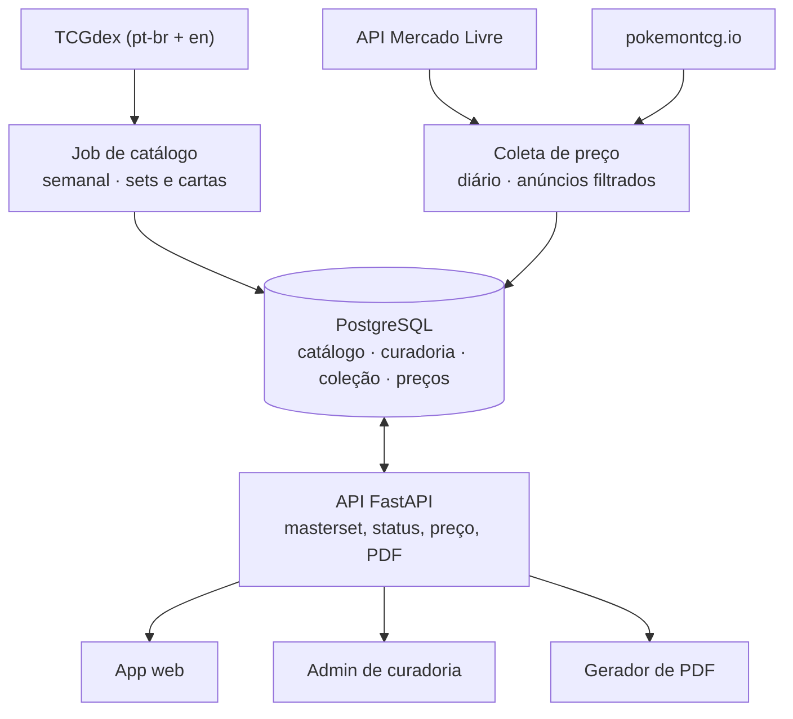

# Masterset BR — Arquitetura

2026-10-13 · Vinicius Teixeira de Lima

## Objetivo e escopo

O app recebe o nome de uma espécie e devolve todos os slots de variante que compõem o masterset dela, com status de coleção, preço em BRL e export para impressão. É o que nenhuma ferramenta atual faz, porque nenhuma modela impressões em português.

Dentro do MVP:

- Busca por espécie, incluindo cartas em que ela aparece junto de outra (Tag Team, Mega, VMAX)
- Geração automática dos slots de variante a partir do catálogo
- Status por slot: tenho / quero / não existe
- Preço de referência em BRL por slot
- Export PDF: checklist e placeholders de fichário

Fora do MVP:

- Scanner de carta por câmera
- Japonês, chinês e coreano
- Trade, marketplace, grading, histórico de valorização
- Multiusuário público e social

Critério de aceite da primeira fase: o masterset de Sableye sai correto e bate com as cartas físicas já conferidas.

## Decisões de arquitetura

Sete escolhas definem o resto do projeto. A primeira é a que mais dói se for revista depois.

| Decisão | Escolha | Por quê | Descartado |
| --- | --- | --- | --- |
| Unidade atômica | `card_variant`, não `card` | O masterset é feito de slots: regular e RF da mesma carta são duas compras, dois preços, dois status | Tratar variante como coluna booleana na carta |
| Catálogo | TCGdex (`pt-br` + `en`), ingestão em job noturno | Gratuito, open source, REST e GraphQL, PT-BR oficial | Consultar a API em tempo real a cada request |
| Impressão em português | Dado curado seu, em tabela própria | Nenhuma API afirma com confiança o que saiu em PT; ausência no TCGdex não prova inexistência | Inferir de `404` da API |
| Preço | Observações datadas, append-only | Preço de carta é série temporal; campo único mutável destrói o histórico e impede mediana | Coluna `preco_atual` na carta |
| Imagens | Hotlink do CDN do TCGdex | Imagem de carta é propriedade da TPCi; não rehospedar reduz exposição e custo de storage | Baixar e servir do seu bucket |
| Idioma | Atributo do slot | O mesmo colecionador mistura PT, EN e JP no mesmo fichário | App separado por idioma |
| Deploy | Monolito FastAPI + Postgres | Volume é de dezenas de milhares de linhas, não milhões; um banco e um processo resolvem | Microserviços, fila, cache distribuído |

## Modelo de dados

Três zonas: catálogo (vem da API, read-only para o app), curadoria (seu dado, editável) e usuário. A tabela `card_species` é o que permite Mega Sableye e Tyranitar-GX aparecer no masterset de Sableye e no de Tyranitar.

```sql
-- ZONA 1: catálogo, sobrescrito pelo job de ingestão
create table card_set (
  id            bigserial primary key,
  tcgdex_id     text unique not null,      -- 'swsh7'
  serie         text not null,             -- 'swsh'
  name_en       text not null,
  name_pt       text,
  release_date  date,
  count_official int,                      -- numeração impressa (ex. 203)
  count_total   int,                       -- com secretas
  symbol_url    text,
  pt_release    text not null default 'unknown'
                check (pt_release in ('unknown','yes','no'))
);

create table card (
  id            bigserial primary key,
  tcgdex_id     text unique not null,      -- 'swsh7-67', igual em todos os idiomas
  set_id        bigint not null references card_set(id),
  number        text not null,             -- texto: '184', 'XY92', 'SV07'
  number_sort   int,                       -- para ordenar
  name_en       text not null,
  name_pt       text,
  rarity_en     text,
  rarity_pt     text,
  illustrator   text,
  image_url     text,
  api_variants  jsonb,                     -- variants cru do TCGdex
  unique (set_id, number)
);

create table species (
  id         bigserial primary key,
  dex_number int not null unique,          -- 302
  slug       text not null unique,         -- 'sableye'
  name_en    text not null,
  name_pt    text not null
);

-- N:N: uma carta pode ter duas espécies (Tag Team)
create table card_species (
  card_id    bigint not null references card(id) on delete cascade,
  species_id bigint not null references species(id),
  primary key (card_id, species_id)
);

-- ZONA 2: curadoria, o diferencial
create type variant_kind as enum (
  'regular','reverse_holo','holo','full_art','alt_art',
  'rainbow','gold','shiny','promo','first_edition'
);

create type lang as enum ('pt','en','ja');

create type existence as enum ('confirmed','unlikely','absent','unknown');

create table card_variant (
  id           bigserial primary key,
  card_id      bigint not null references card(id) on delete cascade,
  kind         variant_kind not null,
  language     lang not null,
  exists_state existence not null default 'unknown',
  source_url   text,                       -- prova da curadoria
  checked_at   timestamptz,
  notes        text,
  unique (card_id, kind, language)
);

-- ZONA 3: usuário
create type slot_status as enum ('owned','wanted','skip');

create table collection_item (
  id            bigserial primary key,
  user_id       bigint not null references app_user(id),
  variant_id    bigint not null references card_variant(id),
  status        slot_status not null,
  quantity      int not null default 1,
  condition     text,                      -- NM, LP, MP...
  paid_brl      numeric(10,2),
  acquired_at   date,
  notes         text,
  unique (user_id, variant_id)
);

-- ZONA 4: preço, append-only
create type price_source as enum ('mercadolivre','manual','tcgplayer','cardmarket','liga');

create table price_observation (
  id          bigserial primary key,
  variant_id  bigint not null references card_variant(id),
  source      price_source not null,
  price_brl   numeric(10,2) not null,
  raw_amount  numeric(10,2),               -- valor na moeda original
  raw_ccy     char(3),
  fx_rate     numeric(10,4),
  listing_url text,
  observed_at timestamptz not null default now()
);

create index on price_observation (variant_id, observed_at desc);

-- materialized view recalculada no job: mediana dos últimos 90 dias
create materialized view price_current as
select variant_id,
       percentile_cont(0.5) within group (order by price_brl) as median_brl,
       min(price_brl) as min_brl,
       max(price_brl) as max_brl,
       count(*) as sample_size,
       max(observed_at) as last_seen
from price_observation
where observed_at > now() - interval '90 days'
group by variant_id;
```

A consulta que gera o masterset é um único join: `species → card_species → card → card_variant`, com `left join` em `collection_item` e `price_current`. Slots com `exists_state = 'absent'` saem da lista por padrão e ficam atrás de um filtro.

## Ingestão do catálogo

O inglês é a espinha, o português é overlay. O `tcgdex_id` é o mesmo nos dois idiomas, então o casamento é direto e não precisa de fuzzy match por nome.

Ordem do job:

1. `GET /en/sets` → upsert em `card_set`
2. Para cada set, `GET /en/sets/{id}` → upsert das cartas, guardando `variants` cru em `api_variants`
3. `GET /pt-br/sets/{id}` → preenche `name_pt`, `rarity_pt`; carta ausente no retorno PT marca `pt_release` do set como candidato a `'no'`, nunca como fato
4. Resolve espécie por parsing do nome da carta contra a lista da PokéAPI, gravando em `card_species`; nome composto (`Mega Sableye e Tyranitar-GX`) gera duas linhas
5. Gera os slots candidatos em `card_variant` a partir de `api_variants` + regras por era
6. Refresh da `price_current`

Cadência: semanal basta, mais um disparo manual quando sai coleção nova. Não há motivo para consultar a API em request de usuário.

As regras por era do passo 5 são o que a API não te dá. Reverse holo só existe a partir de Legendary Collection (2002); antes disso o slot nem deve ser criado. Em coleções da era EX, a RF traz o nome da coleção estampado na arte. Cartas Ultra Rara, Full Art e Rainbow não têm RF. Essas regras viram uma tabela de política indexada por `serie`, aplicada na geração — e tudo que ela produz nasce como `exists_state = 'unknown'`, esperando curadoria.

Ponto de atenção real: a completude do `pt-br` cai muito nas coleções antigas. As eras EX, Diamond & Pearl e HeartGold são exatamente onde o TCGdex tem mais buracos e onde o colecionador brasileiro mais precisa de resposta. Isso não é bug da API, é falta de dado público — e é a justificativa da zona de curadoria.

## Curadoria de variantes

Esta é a camada que vale dinheiro e a única que não vem pronta de lugar nenhum. O job de ingestão produz slots `unknown`; a curadoria os promove a `confirmed` ou `absent`, sempre com `source_url`.

Fontes de evidência, em ordem de confiança:

1. Carta física na mão — a sua coleção vira dado de curadoria
2. Anúncio no LigaPokemon exibindo a impressão em português daquela variante
3. Scan em base pública (TCGdex, Bulbapedia, pkmncards)
4. Relato de colecionador em fórum — só marca `unlikely`, nunca `confirmed`

O admin de curadoria é a tela mais importante do MVP e pode ser feia: lista de slots `unknown` de uma espécie, imagem ao lado, três botões e um campo de URL. Um slot por vez, teclado só. Trinta e cinco slots de Sableye se resolvem numa sessão.

Duas regras que evitam retrabalho: a curadoria nunca é sobrescrita pelo job de ingestão, e todo slot promovido guarda `checked_at`. Quando o TCGdex melhorar a cobertura PT-BR, você compara sem perder o que já confirmou.

Com o tempo, isso vira o ativo do produto: a única base que sabe quais variantes existem em português. É o que nenhum concorrente tem e o que não dá para raspar de ninguém.

## Camada de preço

Nenhuma fonte brasileira tem API pública, então o preço é agregado de várias origens com confiança desigual e sempre datado.

| Fonte | Como entra | Confiança | Custo de obter |
| --- | --- | --- | --- |
| Mercado Livre | API oficial, app registrado e OAuth, busca por termo | Média — são anúncios, não vendas fechadas | Baixo |
| Manual | O que você pagou, digitado no app | Alta para aquele slot | Zero |
| Comunidade | Média dos `paid_brl` de todos os usuários | Cresce com a base | Zero, mas só existe depois |
| TCGplayer / Cardmarket | Via pokemontcg.io, convertido por câmbio do dia | Baixa como preço BR, boa como ordem de grandeza | Baixo |
| LigaPokemon | Scraping da página da carta | Alta | Alto, e com restrição — ver riscos |

A busca no Mercado Livre precisa de termo construído, não do nome cru. Para o slot `Sableye · Céus Evolutivos 067/203 · RF · PT`, o termo é `Sableye 067/203 reverse` com fallback para `Sableye Céus Evolutivos`. Filtro de sanidade obrigatório: descartar anúncios de lote, caixa, booster e coleção, que contaminam a mediana. Um `price_observation` só entra se o título do anúncio contiver o número da carta ou o nome da coleção.

O app nunca exibe um número único. Exibe mediana de 90 dias, faixa e tamanho da amostra. Com amostra menor que três, mostra a faixa e avisa que é estimativa — é mais honesto e evita o colecionador pagar caro confiando num outlier.

## Componentes e API

Nada consulta API externa durante um request do usuário. Fontes externas entram por job; o app lê só o Postgres.



O admin de curadoria escreve pela mesma API; o job de catálogo nunca sobrescreve slot já confirmado.

| Rota | Devolve |
| --- | --- |
| `GET /species?q=sab` | Autocomplete de espécie |
| `GET /species/{slug}/masterset` | Todos os slots com status, preço e imagem |
| `PUT /collection/{variant_id}` | Grava status, condição e valor pago |
| `GET /species/{slug}/export.pdf` | Checklist ou placeholders |
| `GET /admin/pending?species={slug}` | Fila de curadoria |
| `PUT /admin/variant/{id}` | Promove slot, exigindo `source_url` |

## Export para impressão

Dois PDFs, gerados por HTML + WeasyPrint a partir do mesmo template Jinja que alimenta a tela.

Checklist de compra, A4 retrato: uma linha por slot, agrupado por era e coleção, com caixa de marcar, número, variante, idioma, preço mediano e faixa. É o papel que vai junto na loja ou na feira.

Placeholders de fichário, A4 com grade 3×3: um cartão por slot no tamanho de carta, com nome, coleção, número e variante. Imprime, recorta, enche o fichário com os vazios e a coleção passa a mostrar o que falta. É o que o PokeCottage cobra em produto e ninguém oferece em português.

Decisão de implementação: gerar sob demanda e não guardar o PDF. Custo de CPU é baixo, e PDF armazenado envelhece junto com o preço.

## Stack e deploy

| Camada | Escolha | Observação |
| --- | --- | --- |
| Backend | Python 3.12 + FastAPI + SQLAlchemy | Mesmo terreno do pipeline de NF-e; SDK oficial do TCGdex é Python |
| Banco | PostgreSQL 16 | `jsonb` para o payload cru da API, enum nativo, `percentile_cont` para mediana |
| Jobs | APScheduler dentro do processo | Dois jobs por semana não justificam Celery nem Redis |
| Frontend | Next.js + Tailwind | SSR ajuda no SEO se o masterset virar página pública |
| PDF | WeasyPrint | HTML e CSS que você já escreve, sem aprender ReportLab |
| Infra | Docker Compose em VPS, Cloudflare na frente | Uma máquina pequena aguenta; Postgres gerenciado quando passar de usuário único |
| Auth | E-mail e senha, depois OAuth Google | Não inventar identidade própria |

Repositório único, três pastas: `api/`, `web/`, `ingest/`. O `ingest/` é CLI (`python -m ingest sets --lang pt-br`) para você rodar na mão enquanto valida Sableye, e o scheduler apenas chama o mesmo comando depois.

## Roadmap

Cada fase tem um gate verificável. Se o gate não passa, não avança — principalmente o da F1, que é onde o projeto descobre se a tese se sustenta.

| Fase | Entrega | Gate para avançar |
| --- | --- | --- |
| F0 | Schema + ingestão TCGdex, só CLI e SQL | Sableye traz todas as coleções conhecidas, sem duplicata e com a Tag Team ligada às duas espécies |
| F1 | Admin de curadoria + regras de variante por era | Os 35 slots de Sableye classificados, e os 8 que você tem em mãos batem com o que o sistema diz |
| F2 | Tela de masterset + status + export PDF | Você imprime o checklist e usa numa compra real |
| F3 | Coleta de preço (Mercado Livre + manual) | Mediana plausível em 80% dos slots com amostra ≥ 3 |
| F4 | Multiusuário, cadastro, segunda espécie | Um colecionador que não é você monta um masterset sem te perguntar nada |
| F5 | Página pública por espécie, SEO | Tráfego orgânico em "masterset Sableye português" |

F0 a F2 são o produto que resolve o seu problema. F3 em diante é o que transforma em produto de outra pessoa — e só faz sentido se a F1 provar que a curadoria é viável no tempo que você tem.

## Riscos

| Risco | Impacto | O que fazer |
| --- | --- | --- |
| Cobertura `pt-br` fraca nas eras antigas | Masterset incompleto justamente onde dói | A curadoria existe para isso; contribuir de volta ao TCGdex, que é open source |
| Scraping do LigaPokemon | Bloqueio por IP e exposição a ToS | `?view=cards/pricehistory` e `?view=bzr/` estão bloqueados no robots.txt e o `Crawl-delay` é de 360s; não usar como fonte de produto |
| API do Mercado Livre exige app registrado e OAuth | Atraso no F3 | Registrar o app no começo da F2, não na véspera |
| Imagens de carta são da TPCi | Risco se virar produto comercial | Hotlink, nunca rehospedar; se monetizar, revisar com advogado antes |
| Curadoria não escala para 1025 espécies | Produto trava em nicho | Cada espécie curada é valor permanente; abrir contribuição da comunidade com revisão na F4 |
| Você é o único curador | Projeto para quando você parar | Toda promoção de slot exige `source_url`, então outra pessoa consegue auditar e continuar |

O risco que mata é o quinto. Vale medir na F1 quanto tempo levou para curar Sableye por inteiro: multiplicado por cem espécies, esse número decide se isso é um app seu ou um produto.
